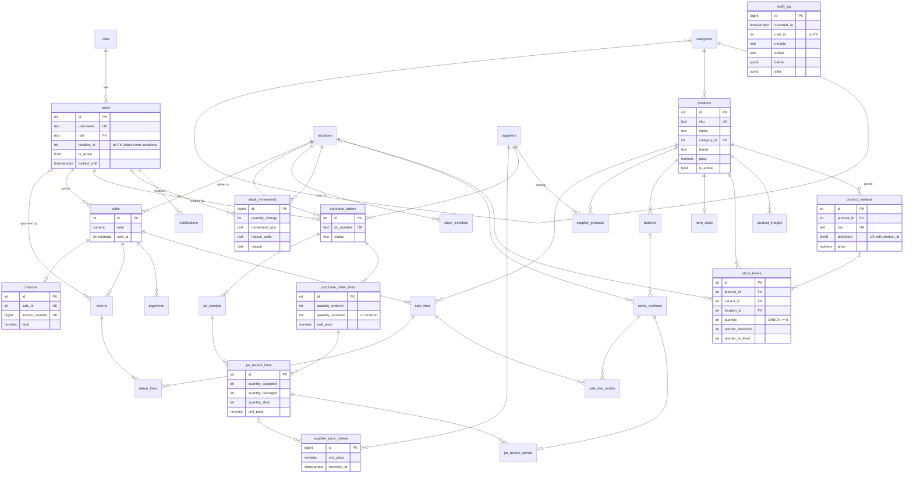

# Database schema

PostgreSQL 16, managed with Alembic (`backend/migrations/`). The models live in each module's
`_internal/models.py` on the shared `Base` in `backend/app/db.py`, and
`backend/migrations/models.py` imports all of them so the metadata is complete.

## Rules

- **Each table has one owning module**, the only module that reads or writes it (see below).
- **Foreign keys across modules point downward only**, the same direction as imports
  (`reporting > sales | purchasing > stock > product > notifications > auth > audit`). A table
  may reference a lower module's table with a real FK. An upward reference is a plain ID
  column, checked by application code:
  - `users.location_id` refers to `locations`, which `stock` owns.
  - `audit_log.user_id` refers to `users`. `username` is also stored as a snapshot, so an
    entry outlives its user.
  - `notifications.location_id` and `reference_id`, and `stock_movements.reference_id`,
    point at higher-module records.
- **No ORM relationships cross modules.** Cross-module FKs use string targets
  (`ForeignKey("products.id")`), never an import of another module's model.
- Enumerations are `text` columns with `CHECK` constraints, because PG enums are awkward to
  migrate. Money is `numeric(12,2)`. Timestamps are `timestamptz`.
- Constraint names come from the naming convention in `app/db.py`. Error handling can match
  them, e.g. `uq_products_sku` or `ck_stock_levels_quantity_non_negative`.

## Table ownership

| Module          | Tables                                                                                                                 |
| --------------- | ---------------------------------------------------------------------------------------------------------------------- |
| `audit`         | `audit_log`                                                                                                            |
| `auth`          | `roles`, `users`, `user_sessions`, `password_reset_tokens`                                                             |
| `notifications` | `notifications`                                                                                                        |
| `product`       | `categories`, `category_attributes`, `products`, `product_variants`, `product_images`                                  |
| `stock`         | `locations`, `stock_levels`, `item_costs`, `batches`, `serial_numbers`, `stock_movements`, `stock_transfers`           |
| `purchasing`    | `suppliers`, `supplier_products`, `purchase_orders`, `purchase_order_lines`, `po_receipts`, `po_receipt_lines`, `po_receipt_serials`, `supplier_price_history` |
| `sales`         | `sales`, `sale_lines`, `sale_line_serials`, `payments`, `returns`, `return_lines`, `invoices`                          |
| `reporting`     | none (it reads through other modules' services)                                                                        |

## Rules enforced by the database

| Rule                                                | How                                                                                       |
| --------------------------------------------------- | ----------------------------------------------------------------------------------------- |
| Unique SKU (FR-1.1)                                 | `UNIQUE` on `products.sku` and `product_variants.sku`. Trigger `enforce_unique_sku` keeps the two in one namespace, using an advisory lock so concurrent inserts are safe. |
| Unique variant combination (FR-1.3)                 | `UNIQUE (product_id, attributes)` on `product_variants`. jsonb equality ignores key order. |
| Category attribute names                            | Unique index on `(category_id, lower(name))`; definitions are inherited by descendants and the nearest ancestor definition wins. |
| Non-negative stock (FR-2.1, NFR-14)                 | `CHECK (quantity >= 0)` on `stock_levels`                                                 |
| One stock row per item per location (FR-2.1)        | `UNIQUE NULLS NOT DISTINCT (product_id, variant_id, location_id)`                         |
| Adjustment needs a reason (FR-2.4)                  | `CHECK` on `stock_movements`: an `adjustment` needs a `reason_code` and a non-blank `reason` |
| Unique serial number (FR-2.5)                       | `UNIQUE` on `serial_numbers.serial_number`. A unit appears on one receipt line.           |
| No over-receipt (A-7, FR-3.3)                       | `CHECK (quantity_received <= quantity_ordered)` on `purchase_order_lines`                 |
| Unique, sequential invoice number (FR-4.3)          | `invoices.invoice_number` defaults to `nextval('invoice_number_seq')` and is `UNIQUE`. One invoice per sale (`UNIQUE sale_id`). |
| Damaged returns are not restocked (FR-4.2)          | `CHECK` on `return_lines`                                                                 |
| Staff and Cashier have a location (A-9)             | `CHECK` on `users`                                                                        |
| Case-insensitive unique username                    | Unique index on `lower(username)`                                                         |
| Case-insensitive unique email                       | Unique index on `lower(email)`                                                           |
| Sessions and reset tokens end with their user       | `ON DELETE CASCADE` from `user_sessions` and `password_reset_tokens` to `users`. Both store only a SHA-256 of the token. |
| Append-only audit log and price history (NFR-8, FR-3.4) | Trigger `reject_modification` rejects `UPDATE`, `DELETE` and `TRUNCATE` on `audit_log` and `supplier_price_history` |

Notes:

- A rolled-back transaction leaves a gap in the invoice sequence. If gapless numbering is
  required, #26 can switch to a counter row locked in the sale transaction.
- Category cycles deeper than self-parenting are left to the application (#10).
- Retention and delete protection for sales, returns and invoices are #27.
- Products and variants are soft-deleted (`is_active`), because sales and stock refer to them.
- An item is a product (`variant_id` NULL) or one of its variants. A product with variants is
  stocked per variant.
- `category_attributes.allowed_values` is either a non-empty JSON array of strings or NULL for
  free text. Variant attribute names and values are trimmed and compared case-insensitively;
  predefined values are stored using their canonical spelling.
- `stock_levels.reorder_to_level` NULL means 2 × `reorder_threshold` (A-4).
  `item_costs.average_cost` NULL means "cost not set" (A-3).
- Search indexes (NFR-1, FR-7): `pg_trgm` GIN indexes on product name, SKU and brand, and on
  variant SKU, plus btree indexes on category, brand and price.

## ER diagram

Columns are abbreviated to keys and the main fields.



## Working with migrations

```bash
docker compose run --rm backend alembic upgrade head        # apply
docker compose run --rm backend alembic downgrade -1        # roll back one revision
docker compose run --rm --user $(id -u):$(id -g) backend \
    alembic revision --autogenerate -m "<change>"            # after editing models
docker compose run --rm backend python -m scripts.seed      # sample data (needs SEED_USER_PASSWORD)
```

Always review an autogenerated revision. Autogenerate does not produce triggers, functions,
sequences or data, so write those by hand, as in `0001_initial_schema`. `tests/test_migrations.py`
fails if the models and migrations drift apart.
